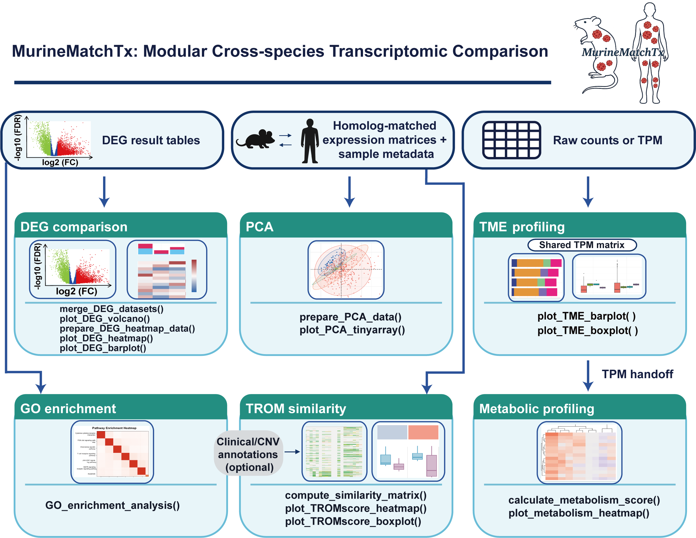

# MurineMatchTx

## 1. Introduction

**MurineMatchTx** is an R package for standardized exploratory comparison of human tumors and mouse cancer models at the transcriptomic level. Users define the research question, select the corresponding module and endpoint, and interpret results within the specified input data, ortholog mapping, and analytical parameters.

### Technical contribution

MurineMatchTx connects explicit sample metadata, standardized DEG inputs, audited ortholog mapping, shared threshold objects, input validation, standardized outputs, package-native visualizations, and an executable workflow. It integrates established methods for DEG comparison, uncorrected PCA, TROM scoring, GO enrichment, and exploratory immune and metabolic profiling through documented cross-module data handoffs.

Each module retains its own endpoint. DEG analysis evaluates tumor-versus-normal regulatory concordance, PCA diagnoses global structure and source effects, TROM measures sample-associated gene-set overlap, GO summarizes functional themes, and TME and metabolic modules describe signals derived from human reference signatures. Conflicting module results remain visible and are interpreted against the prespecified research question rather than combined into a universal score.

### MurineMatchTx package workflow



---

## 2. Installation

You can install the package directly from GitHub:

```r
# Install devtools if necessary
if (!require("devtools")) install.packages("devtools")

# Install the package
devtools::install_github("wangdian-PKU/MurineMatchTx")
```

---

## 3. User Manual

Detailed guidance of how to use MurineMatchTx could be found in the https://wangdian-pku.github.io/MurineMatchTxManual/.

---

## 4. Contact us

We are always open to your questions and encourage discussions here.

You can report potential bugs to the [issues](https://github.com/wangdian-PKU/MurineMatchTx/issues).

Any question can directly contact the author by email: wangdian@bjmu.edu.cn
